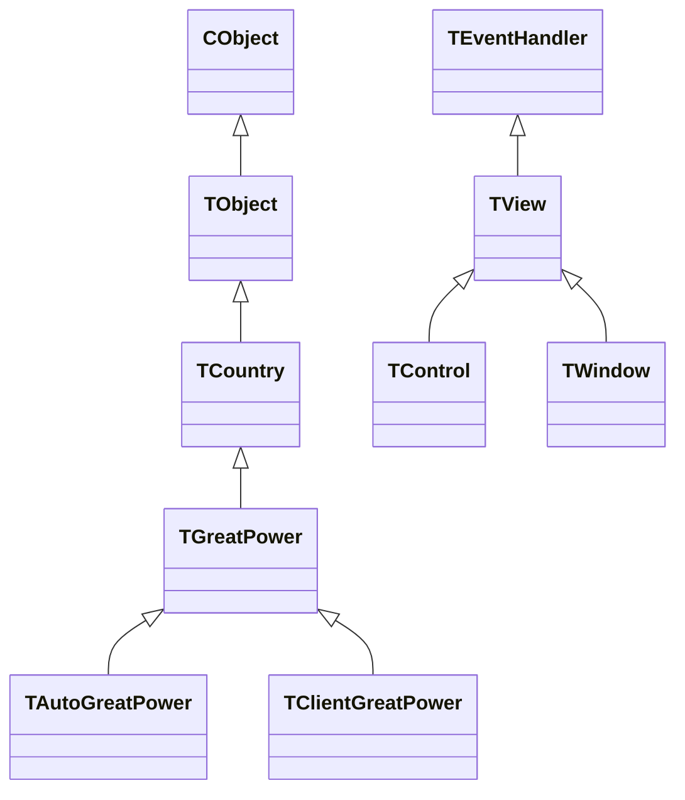

# How the original Imperialism code appears to have been written

Assessment of the original GOG Windows executable, 2026-10-31. This describes the game we
are reverse engineering, not the new C models in `reimpl/` or the proposed portable `core/`.

**The strongest description is: a substantial C++ class framework, with inheritance and
virtual dispatch, whose methods contain conventional imperative game logic.** It uses MFC
and an Ambit application framework, fixed arrays and compiled-in tables, global managers,
specialized subclasses, and some very large dispatch/layout routines. The examples below
show all of these techniques coexisting.

| Question | Assessment | Concrete evidence |
|---|---|---|
| Pure OO? | OO is fundamental to its organization, but state and rules are also represented as arrays, numeric IDs and global managers. | Runtime inheritance in [classes.tsv:153](../classes.tsv#L153); table layouts in [snapshots.md:36](snapshots.md#L36). |
| C with a few MFC hooks? | That understates it. Domain classes inherit through `TObject` to MFC's `CObject`; virtual methods drive simulation and persistence. | [classes.tsv:309](../classes.tsv#L309), [turn_phases.md:3](turn_phases.md#L3); persistence methods at 0x485e90 and 0x49eb30. |
| Table driven? | Partly. Prices, release windows, stocks, diplomacy and some unit definitions are tables. Other definitions are constants passed to constructors/initializers. | [technology.md:12](technology.md#L12), [recipes.md:3](recipes.md#L3), [diplomacy.md:23](diplomacy.md#L23). |
| Huge if/switch chains? | Present in particular jobs: phase sequencing, technology effects and screen construction. They are not the only mechanism used throughout the game. | 0x57da70, 0x5afd00, 0x4357b0; [names/names.tsv:41](../names/names.tsv#L41), [technology.md:55](technology.md#L55), [names/names.tsv:72](../names/names.tsv#L72). |

## What establishes that this really is C++ OO

The class names are not all guesses invented from disassembly. The executable contains
MFC-style `CRuntimeClass` records: name, instance size, schema, creation function and base
class. Our current catalog contains **467 registered classes: 400 `T*` and 67 `C*`**. The
`T*` group includes both game and framework classes; the `C*` group includes custom Windows
adapters as well as MFC classes. This is a catalog of recovered registrations, not a claim
to have counted every original class. [Evidence: build_class_table.py:1](../tools/build_class_table.py#L1),
[record extraction:55](../tools/build_class_table.py#L55), [classes.tsv](../classes.tsv).

For example, the recorded inheritance includes these two chains:

The nation hierarchy supplies different kinds of power behind a common interface; the UI
has its own event/view/control hierarchy. Production also has real order subclasses:
`TOrItemOrder` derives from `TItemOrder`, which derives from `TProductionOrder`.
[Evidence: classes.tsv:98](../classes.tsv#L98), [135](../classes.tsv#L135),
[211](../classes.tsv#L211), [236](../classes.tsv#L236), [317](../classes.tsv#L317),
[147](../classes.tsv#L147), [462](../classes.tsv#L462), [466](../classes.tsv#L466).

This is active architecture, not just unused metadata. The phase controller invokes virtual
methods on nations and managers; production loops invoke methods on order objects. Our
turn trace supplies runtime evidence of those paths. Static direct-call analysis misses
many of them because the destination is selected through a vtable.
[Evidence: turn_phases.md:57](turn_phases.md#L57), [tracer.md:3](tracer.md#L3).

## MFC and Ambit: more than window callbacks

There is a recognizable Windows shell: `CAmbitDocument` derives from `CDocument`,
`CIncludeView` from `CView`, and `CMcWindow` from `CWnd`. Alongside it is the larger Ambit
`T*` framework for objects, events, commands, views, controls and streams. MFC is therefore
part of the foundation of this Windows build, rather than a few isolated calls attached
to an otherwise independent C simulation.
[Evidence: classes.tsv:2](../classes.tsv#L2), [30](../classes.tsv#L30),
[36](../classes.tsv#L36), [144](../classes.tsv#L144), [184](../classes.tsv#L184),
[392](../classes.tsv#L392).

The boundary is not perfectly clean. The turn controller at **0x57da70** constructs and
destroys `CString` objects; so does diplomacy execution at **0x4f01e0**. Framework utility
dependencies reach into simulation routines. Conversely, the bulk of a production rule
can still be arithmetic over stock, labor and capacity, without being a Windows callback.
[Evidence: functions identified in names/names.tsv:41](../names/names.tsv#L41),
[98](../names/names.tsv#L98); [production rule fields: recipes.md:28](recipes.md#L28).

Surviving assert paths distinguish files under `D:\Ambit\` from game files under
`D:\Ambit\Cross\`, including `UCity.cpp`, `UCountry.cpp`, `UNavy.cpp` and `UMap.cpp`.
Names such as `QuickDraw.cpp`, `McAppUI.cpp` and `UMacViewMgr.cpp` suggest a Mac-oriented
cross-platform ancestry. That interpretation is plausible; the paths and names alone do
not establish that it used Apple's or Metrowerks' particular framework, nor that the
Windows and Mac versions had identical implementations.
[Evidence: source_tree.md:3](source_tree.md#L3), [file list:21](source_tree.md#L21).

The matched static MFC 4.21/CRT library code is consistent with the VC++ 5.0 toolchain
documented in this repository. Incremental-link jump stubs also survive. Neither assert
strings nor those stubs alone prove that the distributed game was a Debug build or reveal
every compiler option.
[Evidence: README.md:56](../README.md#L56), [build_class_table.py:5](../tools/build_class_table.py#L5).

## Objects organize the system; methods still do ordinary procedural work

The simulation does not make every good, matrix cell or map tile a separate polymorphic
object. A city stores stock and capacity arrays; the map stores 6,480 fixed-size tile
records and 384 province records. Diplomacy stores four 23-by-23 matrices. Global pointers
provide access to managers, nations and the current game. Objects and densely indexed data
are complementary here.
[Evidence: snapshots.md:36](snapshots.md#L36), [recipes.md:28](recipes.md#L28),
[diplomacy.md:23](diplomacy.md#L23), [snapshot roots: snapshot.py:66](../tools/snapshot.py#L66).

A particularly clear example is **diplomacy execution, 0x4f01e0**. It walks the pending
overture entries for powers and target nations, compares numeric IDs for Consulate,
Embassy and War, and sends other overtures to a virtual method on the target nation.
One method therefore combines table iteration, a short chain of conditions and polymorphism.
Calling it either exclusively procedural or exclusively OO would miss part of its design.
[Evidence: pending tables in diplomacy.md:34](diplomacy.md#L34),
[execution behavior in names/names.tsv:98](../names/names.tsv#L98).

Memory layouts also show explicit allocation and linked structures: a city points
to separately allocated orders/population, while military units are reached through both
province chains and nation roster lists. Our readers must follow these links explicitly.
This looks like manually managed C++ object graphs. Raw allocation and pointer use do not,
by themselves, prove that the original source never used RAII or other C++ conveniences.
[Evidence: snapshots.md:48](snapshots.md#L48), [military layouts:79](snapshots.md#L79).

## Where tables do the work, and where code does

### Production: reusable classes plus configured records

The city initializer at **0x4b2570** creates concrete order objects and configures their
output, inputs and capacity category. Lumber, Paper, Steel and several other goods reuse
`TItemOrder`; Fabric substitutes `TOrItemOrder` for its alternative-input behavior.
Food, power, training, units and other jobs have specialized order types. The generic order
methods at **0x4b5310** and **0x4b5580** use the configured IDs to index stock and capacity,
instead of duplicating the entire manufacturing algorithm for every commodity.
[Evidence: recipes.md:3](recipes.md#L3), [capacity/category behavior:28](recipes.md#L28),
[special orders:41](recipes.md#L41).

There is no single demonstrated universal recipe database. Some configuration is expressed
as explicit initializer calls containing constants. In that same initializer, two groups
of `TUnitOrder` objects are built by iterating static seven-short records around **0x695c50**
and **0x695cde**. This is a mixture of object specialization, reusable algorithms and
compiled-in data. The record-loop observation comes from code inspection of 0x4b2570;
its exact original C++ declaration has not been recovered.
[Function anchor: names/names.tsv:46](../names/names.tsv#L46).

### Technology: data for timing/prices, a switch for effects

Release windows live in a short-pair table at **0x66ab9a**, and purchase prices in a table
at **0x66aaf4**. Scheduling and lookup use these tables. Applying a technology at
**0x5afd00** is different: a technology-ID switch performs particular upgrades and unlocks.
The existence of price/schedule tables does not make the effects themselves declarative.
[Evidence: technology.md:12](technology.md#L12), [table addresses:17](technology.md#L17),
[effect function:55](technology.md#L55), [dump_techtable.py:1](../tools/dump_techtable.py#L1).

### Trade: regular rows with hard-coded exceptions

The market has 17 commodity rows with 23-nation arrays. Settlement at **0x5b8080** loops
over commodities and buyer/seller candidates, with diplomacy checks and deal lists.
Pricing at **0x5b8ad0** has commodity-specific branches/formulas for derived goods,
alongside the general supply/demand calculation. Again, the tables carry state while
ordinary code implements the policy.
[Evidence: trade_rows.txt:1](trade_rows.txt#L1), [row layout:8](trade_rows.txt#L8),
[trade.md:40](trade.md#L40).

These examples establish compiled-in data structures and compiled behavior. They do not
establish a general external scripting or modding system.

## Yes, there are large dispatch and construction routines

The clearest central switch is the **turn phase controller, 0x57da70**: the current
decompile recovers **39 case labels**. Cases update the phase, call subsystem methods and
post events. This is a state machine coordinating work distributed across objects, rather
than containing every game rule itself.
[Evidence: turn_phases.md:3](turn_phases.md#L3), [names/names.tsv:41](../names/names.tsv#L41).

UI construction can be much larger. The routine we label
`TScreenBuilder_HelpAndSmallWindows` at **0x4357b0** dispatches on window IDs and repeatedly
allocates/configures controls with numeric positions, sizes and labels. Its current
decompile occupies roughly **4,000 lines**. The Board of Trade builder at **0x4601b0** has
been recovered as roughly **13,800 decompiled lines**. These are concrete examples of very
large construction routines coexisting with a class-based UI.
[Evidence: names/names.tsv:72](../names/names.tsv#L72), [81](../names/names.tsv#L81).

Those line counts are measurements of decompiler output, not original source lines.
Repeated construction sequences could have been hand-written, macro-expanded or generated
by a layout tool; we have not established which. Likewise, the nested ID comparisons in
the decompile do not tell us whether the programmer originally wrote an `if` tree or a
`switch` that the compiler lowered into comparisons.

## Persistence reflects the same mixed style

The object framework supplies virtual persistence hooks. **0x485e90** dispatches to an
object's read or write method according to archive mode. Document routines **0x49e6a0**
and **0x49eb30** handle headers/schema and invoke the relevant managers/nations in an
explicit order. City's own read/write routines, **0x4b30a0 / 0x4b35d0**, process fields,
arrays and owned objects, including byte-order conversions and a schema-dependent load
path. This is object-based persistence with explicit field/layout policy, not evidence
of an automatic reflection serializer.
[Function address catalog: source_attribution.tsv:272](../names/source_attribution.tsv#L272),
[1336](../names/source_attribution.tsv#L1336), [1000](../names/source_attribution.tsv#L1000);
[stream classes: classes.tsv:392](../classes.tsv#L392),
[trade's serialized rows/schema handling: trade_rows.txt:8](trade_rows.txt#L8).

## Limits of this assessment

Class registrations, allocations, stored constants, memory layouts and observed dispatch
are the strongest evidence. The C-like syntax emitted by Ghidra is weaker evidence of
original source style: it flattens methods, loses member names/types, exposes compiler
cleanup machinery, and sometimes misses implicit `this` adjustments. We have already
encountered such an adjustment while decoding a list header.
[Evidence: field_miner.md:51](field_miner.md#L51), [list correction:63](field_miner.md#L63).

Names such as `TGreatPower` survive in runtime metadata. Names such as
`TSimMgr_AdvancePhase`, `TCity_Reset` and `TScreenBuilder_HelpAndSmallWindows` are our
descriptive labels, with confidence recorded in `names/names.tsv`; `_vfN` names are
generated from vtable slots. They should not be mistaken for recovered original method
names. In `classes.tsv`, `classVA` is the runtime-class record address, not the vtable.
[Evidence: name_classes.py:60](../tools/name_classes.py#L60),
[manual naming:80](../tools/name_classes.py#L80), [class record extraction:55](../tools/build_class_table.py#L55).

We can characterize these mechanisms confidently without claiming to know the programmers'
exact source formatting, macro use, development workflow, every class boundary, or the
proportion of the whole game written in each style. Much of the military AI remains
semantically undecoded, and a large source-attribution boundary remains open.
[Evidence: STATUS.md](STATUS.md), [source_tree.md:48](source_tree.md#L48).
